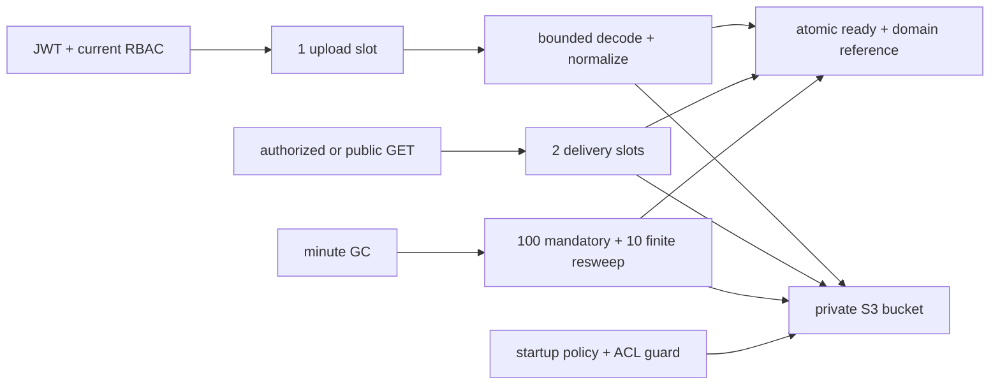

# Media Storage — исправления независимого аудита

Дата: 2026-11-16. Ветка `feat/media-storage-seaweedfs`, HEAD/origin/main
`f4edad26e98f366fb3af98335f10a974d29a109f`. Состояние Phase 1/2 сохранено.
Commit, push, merge, rebase и миграция пользовательской БД не выполнялись.

**Итог: READY FOR MERGE для согласованного локального MVP.** Все пять
подтверждённых дефектов закрыты регрессионными проверками. Это не заключение
о готовности публичного production и не гарантия отсутствия всех уязвимостей.

## Воспроизведение → исправление → регрессия

До правок дефекты подтверждены независимыми probes исходного рабочего дерева
(сохранённые `/tmp/srez-independent-audit/probes_test.go`,
`persistence_probe_test.go`, `srez-independent-audit-probes.log`). Они использовали
изолированные PostgreSQL/SeaweedFS, overlay без изменений исходников. Повторять
unsafe controls на пользовательских bucket не требовалось. Ниже указаны исходные
наблюдения и ожидаемое поведение; адаптированные проверки теперь находятся в репозитории.

| ID             | Подтверждённая причина и исходный результат                                                                                    | Исправление                                                                                                                                                                      | Новый проверенный результат                                                                                                                                                                                                                                                     |
| -------------- | ------------------------------------------------------------------------------------------------------------------------------ | -------------------------------------------------------------------------------------------------------------------------------------------------------------------------------- | ------------------------------------------------------------------------------------------------------------------------------------------------------------------------------------------------------------------------------------------------------------------------------- |
| AUD-M01 Medium | Startup сохранял внешний public Allow; private avatar proxy=404, anonymous S3 GET/List=200                                     | GetBucketAcl + консервативный анализ разрешений policy до SetMedia/Run; unverifiable privacy закрывает startup; безопасные external statements сохранены                         | Fresh/private bucket и private external policy принимаются. Реальные public GetObject/ListBucket/ACL controls дают anonymous=200, затем initialization отказывает. Private=403. ACL 403/501/неполный XML закрывают startup без policy mutation. Старый staging PUT остаётся 403 |
| AUD-M02 Medium | Два stalled anonymous TCP GET занимали оба shared slots, upload=429                                                            | Один reserved upload/decoder slot, два delivery slots, без очереди; delivery slot держится до завершения HTTP write                                                              | Те же два stalled TCP GET: authenticated upload=200; 20 запросов gallery burst=429; disconnect освобождает GET slots. Upload TCP disconnect и 10s timeout освобождают decoder slot; следующая загрузка=200. Unit cancellation и race PASS                                       |
| AUD-M03 Medium | Из 6100 due deleted tombstones выбирались только первые 100, свежий expired processing не попадал в batch; resweep бесконечный | 011: deleted_at/reconcile_until/resweep_after, отдельные бюджеты 100 mandatory +10 resweep, 24h окно, индексы и backlog; выбранный resweep становится deleting для durable retry | 6100 tombstones +1 fresh: fresh выбран, 10 resweep, live ref не выбран. DELETE failure повторён; late PUT удалён. Failed resweep повторяется даже после конца окна. После окна work=0, 6101 audit rows сохранены                                                                |
| AUD-L01 Low    | GET body не читался: truncated HTTP response с заявленной длиной 16 проходил restart test                                      | Полный bounded GET <=8 MiB+1, read errors, точная длина и SHA-256; реальный normalized ready avatar с SQL reference                                                              | Truncated HTTP body и altered same-length payload отвергаются. Реальный volume restart: полный hash до/после совпал; proxy read по действующей SQL reference тоже совпал                                                                                                        |
| AUD-L02 Low    | Adapter удалял из runtime bucket B, хотя metadata указывала A, после чего A-row ошибочно становился deleted                    | Перед read/upload claim/finalize/Delete проверяется saved bucket == active bucket; legacy cleanup тоже сверяет location; явный sentinel и безопасный operational log             | A→B без переноса: read/cleanup возвращают config error; A-row не deleted, файл A сохранён и совпадающий key в B не удалён. При неизменном bucket весь flow проходит                                                                                                             |

## Архитектура и бюджет



Codec concurrency уменьшена с двух до одного. Два delivery buffers ограничены
8 MiB каждый по логической длине; ReadAll capacity, исходный буфер <=5 MiB,
normalized encoder buffer и decoded raster имеют дополнительные allocations.
Ограничения source/output/pixels/dimensions и фиксированная concurrency задают
общий бюджет работы, но не точный hard RSS/CPU limit. Публичный GET не занимает
upload slot; decoder workload не удвоен. Нет goroutine/queue на ожидание слота.

GC сначала выбирает до 100 expired processing/deleting, затем отдельно до 10
terminal resweeps. SQL locks отпускаются до request state update и S3 I/O;
parent→request→asset порядок прежний. Отсутствие references проверяется при claim,
terminal asset нельзя снова привязать. delete_after сохраняет исходный due time
для возраста backlog. Успешный DELETE не продлевает reconcile_until; ошибка
выбранного DELETE оставляет deleting и не теряется при restart/окончании окна.
Audit history не удаляется. Legacy cleaned rows тоже имеют конечный resweep.

Логи `media_gc pending=... oldest_seconds=... reconciliation=...` показывают размер
и возраст обязательной очереди и due reconciliation. `media_bucket_configuration_mismatch`
даёт оператору причину без bucket/key/credentials. Конфигурационный перенос bucket
описан в [руководстве](media-storage.md#перенос-bucket).

Privacy guard допускает owner-only ACL и заведомо непубличные policy principals;
неизвестные формы Allow/NotPrincipal, wildcard и conditional public grants
отклоняются консервативно. Это осознанно уже полного IAM evaluator. Проверки
реальных anonymous прав выполнены на закреплённом SeaweedFS 4.54, включая public
bucket ACL (он предоставляет ListBucket, а не автоматически GetObject).

## Проверки

Финальный изолированный проект: `srez-media-test-1794842627-72184`.
Свежие named volumes, случайные credentials, динамические loopback ports,
случайные schemas для обычных тестов и отдельная schema для cross-process restart.
Только containers/network этого проекта остановлены и удалены через down без -v.
Volumes сохранены; пользовательские volumes не подключались и не удалялись.

| Проверка                                                                                                 | Результат                                                 |
| -------------------------------------------------------------------------------------------------------- | --------------------------------------------------------- |
| gofmt -l internal cmd migrations                                                                         | PASS, пустой вывод                                        |
| go test ./... -count=1                                                                                   | PASS с реальными PostgreSQL + SeaweedFS                   |
| go vet ./...                                                                                             | PASS                                                      |
| git diff --check                                                                                         | PASS                                                      |
| docker compose config --quiet, также media-test.yaml                                                     | PASS с временными сгенерированными env; .env не изменён   |
| docker build -t srez-media-audit-fixes-review .                                                          | PASS, linux/arm64                                         |
| scripts/test-media.sh                                                                                    | PASS, весь suite + focused security/regressions + restart |
| go test -race ./internal/usecase ./internal/handler ./internal/storage ./internal/objectstorage -count=1 | PASS на реальных test services, race не обнаружены        |
| Исходные auth/refresh/CSRF/RBAC/PVM/catalog/cart/wishlist/orders/reservations/history проверки           | PASS в общем PostgreSQL suite                             |
| Migration 009 upgrade + runner, 001–010 checksums                                                        | PASS; новая 011, старые файлы не редактировались          |
| S3 credentials в logs                                                                                    | Не найдены до/после restart                               |

Полный suite: handler 19.761s, storage 18.574s, objectstorage 0.699s,
usecase 1.302s. Race: handler 36.974s, storage 18.890s, objectstorage 2.228s,
usecase 2.407s. Обычный go test без TEST_DATABASE_URL/TEST_S3_ENDPOINT пропускает
service-dependent tests — такой запуск не засчитывался за integration PASS.
Restart-only тест пропускается в общем suite и затем явно выполняется до/после restart.

Логи локального прогона: `/tmp/srez-audit-fixes-final-suite.log`,
`/tmp/srez-audit-fixes-build.log`. Они не содержат конфигурационные credentials.

### Реальный restart, полный payload

Ready avatar id=1 с действующей user.avatar_media_id, нормализованный alpha PNG.

```text
before: bytes=4843299 SHA-256=416918961832af6a0bb4818a0682b7253cc5e6ad0aeb05f48a36aef309f5b366
after:  bytes=4843299 SHA-256=416918961832af6a0bb4818a0682b7253cc5e6ad0aeb05f48a36aef309f5b366
```

Проверены HEAD length, полный bounded GetObject, отсутствие ошибок чтения,
actual length и digest; затем Media.Read по ready+live reference с теми же bytes/hash.
Expected size/hash записаны в isolated PostgreSQL перед restart, не вычислены
из повреждённого объекта после restart. Port перечитан после restart.

## Повторный read-only review

Проверен итоговый tracked diff и новые media files, startup call order, semaphore
ownership, SQL scheduling/constraints, bucket checks, migration preservation,
legacy reads/writers и негативные тесты. Подтверждённых новых Critical/High и
незакрытых пяти исходных находок не обнаружено. RBAC/visibility и atomic ready/ref
не ослаблены; сеть вне долгих SQL transaction; lock inversion не добавлен.
Race suite не обнаружил data races. Review не заменяет production load/security testing.

## Остаточные ограничения

- Не осталось подтверждённых открытых AUD-M01/M02/M03/L01/L02. Исходные Medium/Low
  устранены в согласованной модели одного bucket и локального MVP.
- Runtime S3 identity пока admin; bootstrap/runtime разделение и регулярная
  проверка drift policy/ACL нужны перед production. Внешний admin может поменять
  policy уже после startup; постоянного мониторинга сейчас нет.
- S3 startup failure по-прежнему блокирует весь API и order worker. Это отдельный
  availability follow-up, не менялся в данной задаче.
- Нет hard CPU preemption codec, distributed rate limits, disk quotas, CDN,
  публичного load test и независимого масштабируемого GC worker.
- Finite 24h reconciliation предполагает bounded backend/SDK writes. Долгий outage
  GC/S3 или внешняя запись спустя дни требуют operator inventory reconciliation.
  Resweep eligibility раз в час не означает SLA при переполненной очереди;
  backlog/age нужно наблюдать. Выбранные failed DELETE продолжают retries.
- Неоднозначный успешный COMMIT проверен unit fault model, а не реальным разрывом
  PostgreSQL TCP точно в COMMIT. Реальный rollback после S3 проверен отдельно.
- Audit history сохраняется; retention/архивация требуют отдельного решения.

## Файлы текущего исправления

Изменены: `cmd/app/main.go`, `internal/objectstorage/s3.go`,
`internal/usecase/media.go`, `internal/usecase/media_test.go`,
`internal/storage/media.go`, `internal/storage/media_integration_test.go`,
`internal/storage/catalog_integration_test.go`,
`internal/handler/media_integration_test.go`, `scripts/test-media.sh`,
`docs/architecture.md`, `docs/media-storage.md`,
`docs/media-storage-security-review.md`, `docs/media-storage-validation.md`.

Добавлены: `internal/objectstorage/privacy.go`,
`internal/objectstorage/privacy_test.go`,
`internal/handler/media_audit_regression_test.go`,
`migrations/011_media_gc_reconciliation.sql`, этот отчёт.

## Полный список файлов рабочего diff относительно main

Включает сохранённую незакоммиченную Phase 1/2, а не только данный фикс.

- `.env.example`
- `Dockerfile`
- `README.md`
- `cmd/app/main.go`
- `compose.yaml`
- `docs/architecture.md`
- `docs/product-variant-management.md`
- `go.mod`
- `go.sum`
- `internal/entities/brand.go`
- `internal/entities/product.go`
- `internal/entities/product_color.go`
- `internal/entities/product_image.go`
- `internal/entities/user.go`
- `internal/handler/auth.go`
- `internal/handler/catalog_dto.go`
- `internal/handler/catalog_management_integration_test.go`
- `internal/handler/handler.go`
- `internal/handler/management.go`
- `internal/handler/product_variants.go`
- `internal/handler/product_variants_integration_test.go`
- `internal/handler/user.go`
- `internal/handler/user_test.go`
- `internal/storage/brand.go`
- `internal/storage/catalog_integration_test.go`
- `internal/storage/order_cancellation_migration_integration_test.go`
- `internal/storage/product.go`
- `internal/storage/product_catalog.go`
- `internal/storage/product_variants.go`
- `internal/storage/shopping.go`
- `internal/storage/user.go`
- `internal/usecase/product_variants.go`
- `compose.media-test.yaml`
- `deploy/seaweedfs-entrypoint.sh`
- `docs/media-storage-audit-fixes.md`
- `docs/media-storage-security-review.md`
- `docs/media-storage-validation.md`
- `docs/media-storage.md`
- `internal/config/media.go`
- `internal/handler/media.go`
- `internal/handler/media_audit_regression_test.go`
- `internal/handler/media_integration_test.go`
- `internal/handler/media_test.go`
- `internal/objectstorage/privacy.go`
- `internal/objectstorage/privacy_test.go`
- `internal/objectstorage/s3.go`
- `internal/objectstorage/s3_test.go`
- `internal/storage/media.go`
- `internal/storage/media_integration_test.go`
- `internal/storage/media_migration_integration_test.go`
- `internal/usecase/media.go`
- `internal/usecase/media_test.go`
- `migrations/009_media_uploads.sql`
- `migrations/010_media_ownership.sql`
- `migrations/011_media_gc_reconciliation.sql`
- `scripts/test-media.sh`
