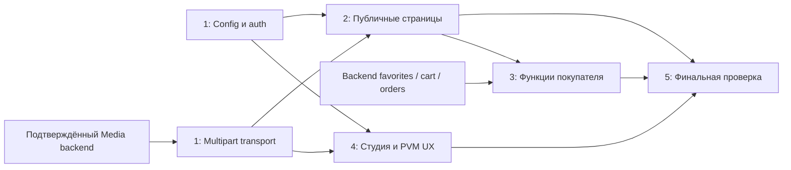

# SREZ: аудит и план развития frontend

Дата: **16.11.2026**, Europe/Moscow. Статус: инфраструктура, авторизация и публичная часть реализованы локально. Первоначальный аудит сохранён как история; актуальное выполнение — разделы 11–12. Подробный отчёт публичного этапа — [PUBLIC.md](PUBLIC.md).

## 1. Область проверки и основной вывод

Рабочая копия: `C:\dev\team-repository`. Локальная ветка `feature/product-variant-management`, HEAD `e8c9746`. Внутри родительской рабочей папки также есть `original-project` и `prepared-project`: это не рабочие копии для внесения изменений. Поиск SeaweedFS/upload в них также не обнаружил соответствующей реализации. Никакие файлы из этих папок не переносились.

Источником истины служат локальные Go/TypeScript/SQL-файлы, включая незакоммиченный `frontend/`. Проверены структура, регистрация маршрутов, DTO, auth/security/config, каталог, управление брендами, PVM, миграции, Compose, README и все документы `docs/`, включая архивное ТЗ. На GitHub проверка не опирается.

**Существующий frontend пригоден для развития. Полный rewrite не нужен.** В нём уже работают с реальным API каталог, аккаунт и студия owner/editor с PVM. Основная оставшаяся работа — интеграция недостающих backend-контрактов, покупательские сценарии, загрузка файлов и доработка существующего UX.

**Критическое расхождение с вводным описанием задачи:** в этой рабочей копии нет подтверждённой реализации загрузки файлов через Go/SeaweedFS. В `cmd/app`, `internal/`, миграциях, `go.mod` и Compose нет соответствующего модуля, маршрутов, конфигурации или сервиса. Текущий PVM сохраняет переданные HTTPS URL; это не Media Storage. Аналогично отсутствуют API/таблицы/страницы избранного, корзины и заказов. Это вывод о проверенной рабочей копии, а не о других ветках, удалённом репозитории или всём компьютере.

Если соответствующий backend уже разработан командой, следующий шаг — получить точное расположение его локального кода/контракта и повторно сверить эти разделы. Самостоятельно переключать ветку, обновлять репозиторий или заменять текущие файлы в рамках этого аудита нельзя. Не следует писать frontend под угаданные маршруты.

В рамках первоначального аудита был добавлен только этот документ. Существующий код и конфигурация сохранены. Команды изменения истории Git, удалённые операции, создание PR, запуск/остановка контейнеров и удаление данных не выполнялись.

## 2. Состояние проекта

### 2.1. Структура и ответственность

| Каталог/файл от корня репозитория                           | Фактическая роль                                                                              |
| ----------------------------------------------------------- | --------------------------------------------------------------------------------------------- |
| `cmd/app`                                                   | Сборка зависимостей, соединение с PostgreSQL, миграции, запуск Gin                            |
| `cmd/seed`, `internal/devseed`                              | Отдельный явный демонстрационный seed; сервер не запускает его автоматически                  |
| `internal/config`                                           | HTTP/DB, auth keys, exact Origin, режим локальной cookie, лимиты                              |
| `internal/entities`                                         | Пользователь, сессия, бренд, membership, товар, цвет, изображение, вариант; доменные проверки |
| `internal/handler`                                          | 44 зарегистрированных HTTP-маршрута, DTO, Bearer, Origin/CSRF, ошибки                         |
| `internal/usecase`                                          | Auth, публичный каталог, Management/RBAC/PVM, интерфейсы репозиториев                         |
| `internal/storage`                                          | PostgreSQL/sqlx, SQL, транзакции и блокировки                                                 |
| `internal/security`                                         | Argon2id, JWT, refresh/CSRF primitives                                                        |
| `migrations`                                                | 001 users, 002 catalog, 003 auth, 004 memberships, 005 stable image IDs; runner               |
| `docs/architecture.md`                                      | Архитектура/auth/RBAC/PVM; часть статусов frontend устарела                                   |
| `docs/catalog-api.md`, `docs/product-variant-management.md` | Контракты существующих каталога и PVM                                                         |
| `docs/legacy/SPEC.md`                                       | Архив занятия; не спецификация современного маркетплейса                                      |
| `frontend/src`                                              | Существующее React-приложение, API/session client, страницы и общий UI                        |
| `frontend/public`                                           | Декоративная иллюстрация и favicon; не товарные данные                                        |
| `frontend/e2e`, `frontend/src/lib/*.test.ts`                | Один большой браузерный сценарий и unit-тесты                                                 |
| `frontend/scripts`                                          | Подготовка локального `.env`, отдельный тестовый API                                          |
| `compose.yaml`, `Dockerfile`                                | Go app и PostgreSQL 16; frontend работает через npm на хосте                                  |
| `compose.frontend.yaml`                                     | Override Origin на `http://127.0.0.1:5173` и существующий local HTTP auth mode                |

Backend сохраняет слои `handler → usecase → storage`, доменные правила находятся в `entities`. PVM расширяет существующий Management, а не вводит отдельный механизм разрешений. Внутри транзакции проверяются бренд, действующее членство и принадлежность дочерних объектов. Эти границы нужно сохранить.

### 2.2. Библиотеки frontend

Установленные версии из локального `package.json`: React/React DOM 19.3.1, React Router DOM 7.18.5, Vite 8.3.8, TypeScript 7.0.2. Шрифт Manrope 5.3.0 подключён локально. Проверки: Vitest 5.1.0, Playwright 1.65.1, Prettier 3.10.1. Настроен строгий TypeScript.

Используются обычный CSS с переменными и media queries, контролируемые формы React, Context для auth/toast, `useSyncExternalStore` для сессии, собственные `useLoad`/`useAction`. Redux, библиотека server-state cache, UI framework и form-library не используются. Их отсутствие само по себе не дефект и не повод менять стек.

### 2.3. Реально существующие страницы

| URL frontend                                  | Компонент           | Источник данных и состояние                                                         |
| --------------------------------------------- | ------------------- | ----------------------------------------------------------------------------------- |
| `/`                                           | `HomePage`          | Реальные последние 4 товара и активные бренды из API; hero — декоративный SVG       |
| `/catalog`                                    | `CatalogPage`       | API: фильтры category/brand/price/size/color, сортировка, пагинация по заголовкам   |
| `/products/:productId`                        | `ProductPage`       | API: детали, галерея, цвета, размеры, остатки; бренд находится через список брендов |
| `/brands`                                     | `BrandsPage`        | API: активные бренды                                                                |
| `/brands/:slug`                               | `BrandPage`         | API: бренд, контакты, первые 12 товаров; ссылка в полный каталог бренда             |
| `/register`, `/login`                         | `AuthPage`          | Настоящие register/login; после регистрации отдельно вызывается login               |
| `/account`                                    | `AccountPage`       | Настоящий собственный профиль, имя/аватар по URL, logout                            |
| `/studio`                                     | `StudioPage`        | Мои бренды, роли, приглашения; принятие/отклонение                                  |
| `/studio/brands/new`                          | `NewBrandPage`      | Создание draft-бренда; slug может транслитерироваться из имени                      |
| `/studio/brands/:brandId`                     | `BrandStudioPage`   | Управляющий список товаров бренда, включая draft/hidden                             |
| Тот же URL, `?tab=settings`                   | `BrandSettings`     | Owner-only настройки/контакты/appearance и публикация бренда                        |
| Тот же URL, `?tab=team`                       | `Members`           | Owner-only приглашения и отзыв editor; участники отображаются по ID                 |
| `/studio/brands/:brandId/products/new`        | `NewProductPage`    | Создание настоящего draft-товара                                                    |
| `/studio/brands/:brandId/products/:productId` | `ProductEditorPage` | Основные поля и CRUD цветов, размеров, stock/SKU, HTTPS URL фото и их порядка       |
| Любой неизвестный URL                         | `NotFound`          | Локальная 404-страница                                                              |

Все страницы начиная с `/account` и `/studio` защищены `RequireAuth`. Editor не видит вкладки owner; прямой `?tab=settings` для него показывает товары. Сервер остаётся авторитетным источником разрешений.

Страниц избранного, корзины, checkout, истории/деталей заказов и file upload сейчас нет. В текущем UI нет притворяющихся рабочими кнопок покупки или оплаты — эти сценарии ещё не реализованы.

### 2.4. Фиктивные данные и переиспользуемый UI

- Выдуманного массива товаров/брендов, подмены `fetch` или runtime mock API в `src/` нет. Страницы используют `lib/api.ts`/`SessionClient` и настоящую БД через Go.
- Статические тексты hero, SVG худи, список допустимых категорий, иконки и нейтральные заглушки фотографий — оформление/справочники, не ответы API.
- Тестовые аккаунты/фотографии находятся в E2E, примеры `example.com` — в документации/seed. Они не являются источником товара на frontend. Seed попадает в БД только при явном запуске.
- `GET /projects` действительно возвращает фиксированный учебный список, но React-маркетплейс его не использует.
- Сохранить `Layout`, навигацию/footer, `Button`, `Field`, `Icon`, `Media`, `Avatar`, `ProductTile`, `PageTitle`, `Status`, `Empty`, `Loading`, `LoadError`, `Notice`, `Confirm`, `ToastProvider`, форматирование денег и HTTPS-валидацию в рамках действующего контракта.
- Сохранить существующий session client, guards, URL-фильтры и PVM API adapters. Расширять их адресно, а не заменять всё приложение.

### 2.5. Дизайн

Основа уже соответствует streetwear-направлению: чёрно-белая палитра, крупная типографика, прямоугольные контролы, товарные сетки, адаптивные состояния. Шрифт не зависит от Google Fonts. Есть focus styles, skip link, alt-тексты, native confirm-dialog и reduced-motion CSS.

Предлагаемые доработки без смены визуальной системы:

1. Поднять читаемость важных label/hint/status на телефоне: в CSS много размеров 8–11 px. Проверить контраст, масштаб 200% и touch targets, особенно управление фотографиями.
2. Улучшить клавиатурное управление вкладками: сейчас есть `role=tab`, но нет полного поведения стрелок/Home/End и связанного `tabpanel`. Проверить focus после модальных действий и мобильного меню.
3. Сохранить палитру SREZ; отдельно решить, должны ли `brand.appearance` влиять на публичную страницу бренда. Сейчас значения сохраняются, но там не применяются. Не применять непроверенные CSS-строки напрямую.
4. Показать явные состояния загрузки файла, обработки, ошибки и привязки к товару; не рисовать фиктивный процент прогресса.
5. После появления buyer API добавить понятные действия избранного/корзины и счётчики в существующий header. На карточке различать «не выбран размер» и «нет в наличии».
6. Для редактора добавить видимый статус несохранённых изменений и конкретный список недостающих полей перед публикацией. Глобальный toast дополнить устойчивыми ошибками рядом с полями.

Это оценка локальных компонентов/CSS и имеющихся артефактов предыдущей проверки. Новая полноценная визуальная проверка всех страниц в браузере в этом аудите не выполнялась.

## 3. Реальные контракты и безопасность

### 3.1. Общие правила

- Таблицы ниже показывают **пути Go API без `/api`**. Браузер добавляет `/api`; Vite удаляет префикс и проксирует на `127.0.0.1:8080`.
- 44 маршрута: 16 GET, 18 POST, 6 PATCH, 4 DELETE. Регистрация: `internal/handler/handler.go`, `auth.go`, `management.go`, `product_variants.go`.
- JSON mutation DTO строгие, неизвестные поля отклоняются; лимит JSON-тела 64 КиБ. `null` в pointer-полях PATCH сейчас обычно означает пропуск, не удаление. Переходы статусов принимают `{}`.
- Цены — целые копейки. UI принимает рубли. Даты — RFC 3339. ID, цена и stock в Go/SQL могут быть int64, тогда как frontend использует `number`: значения за `Number.MAX_SAFE_INTEGER` требуют отдельного согласованного контракта. Строковые ID самовольно не вводить.
- Ответ списка товаров — массив, не `{items,meta}`. Пагинация: `X-Total-Count`, `X-Page`, `X-Limit`, `X-Total-Pages`. Backend default: page=1, limit=20, sort=id_asc; frontend осознанно запрашивает limit=12 и newest.
- Размер/цвет фильтруют доступные варианты со stock > 0. Stock=0 допустим; published-товар без остатков остаётся в общем каталоге.
- Ошибки: `{"error":"..."}`. Обычно 400 — входные данные, 401 — auth, 403 — запрет, 404 — скрытый/чужой/отсутствующий объект, 409 — конфликт/неполная публикация, 413 — размер тела. Auth также возвращает 415/429/503. Сейчас нет единого стабильного кода ошибки/field errors, отдельного от текста.

### 3.2. Сокращения DTO в таблицах

| Имя              | Формат                                                                                                                                                                                     |
| ---------------- | ------------------------------------------------------------------------------------------------------------------------------------------------------------------------------------------ |
| `PublicUser`     | `{id, username, display_name, avatar_url}`; без email/хеша                                                                                                                                 |
| `Profile`        | `PublicUser` + `email`; только собственный пользователь                                                                                                                                    |
| `AuthResult`     | `{access_token, csrf_token}` + серверная refresh-cookie; refresh не приходит в JSON                                                                                                        |
| `Brand`          | `{id,name,slug,description,logo_url,banner_url,contacts:{email,telegram_url,website_url},appearance:{accent_color,background_color,text_color},status,created_at,updated_at}`              |
| `MyBrand`        | `{brand: Brand, role}`; role принимает `owner` или `editor`                                                                                                                                |
| `Membership`     | `{user_id,brand_id,role,status,invited_by_user_id,invited_at,joined_at,created_at,updated_at}`; без username/email участника                                                               |
| `Product`        | `{id,brand_id,name,description,price_kopecks,category,materials:string[],status,created_at,updated_at}`                                                                                    |
| `ProductInput`   | `{name,description,price_kopecks,category,materials}`; POST дополнительно принимает `brand_id`                                                                                             |
| `ProductCard`    | `Product` + `{preview_image_url,brand_name,brand_slug,is_available,available_colors:string[],available_sizes:string[],colors:[{id,color,preview_image_url,is_available,available_sizes}]}` |
| `ProductDetail`  | `Product` + `colors:[{id,color,images:string[],variants:[{id,size,stock,sku}]}]`                                                                                                           |
| `ManagedColor`   | `{id,product_id,color,images:string[]}`                                                                                                                                                    |
| `ManagedVariant` | `{id,product_color_id,size,stock,sku}`                                                                                                                                                     |
| `ManagedImage`   | `{id,product_color_id,url,position}`; image ID стабилен, position меняется                                                                                                                 |

Контакты/appearance при передаче в PATCH бренда заменяются целиком. SKU — необязательная строка: **уникальность SKU в домене/БД не гарантируется**. Уникальны нормализованные имена цвета внутри товара, размера внутри цвета и URL внутри цвета. Для фотографий максимум 10 и позиции 0–9.

### 3.3. Auth и роли, которые нужно сохранить

Access JWT HS256 действует 15 минут и проверяет обязательные claims. Brand-role не берётся из JWT: usecase проверяет активное членство в БД внутри транзакции. Пароли: Argon2id, минимум 12 Unicode-символов, максимум 1024 байта. Восстановления пароля/подтверждения email в этой копии нет.

Refresh — непрозрачный токен в HttpOnly/SameSite=Strict cookie, абсолютный срок 7 дней, ротация и replay detection. Локально cookie `srez_refresh_local`; вне local HTTP — `__Host-srez_refresh` с Secure. Logout отзывает refresh-сессию, но уже выданный access JWT может жить до exp. Отзыв membership при этом проверяется на следующем management-запросе, даже со старым JWT.

Auth POST требуют точный Origin из `SREZ_PUBLIC_ORIGIN`, JSON и допустимый `Sec-Fetch-Site`. GET `/auth/csrf` допускает отсутствие Origin у same-origin браузерного GET. Refresh/logout требуют текущую cookie и `X-CSRF-Token`; csrf восстанавливается через GET, JavaScript не читает HttpOnly cookie.

Frontend уже хранит access только в памяти, делает single-flight refresh, использует Web Locks и локальную очередь для cookie-операций, BroadcastChannel для logout/смены сессии без токенов. Приватный 401 повторяется один раз с новым JWT; 403/404 не маскируются refresh. Успешное восстановление завершается запросом профиля. Это следует расширять регрессионными тестами, сохранив текущую модель.

Обозначения ниже: `JWT` — любой вошедший пользователь; `O/E` — действующий owner/editor конкретного бренда; `O` — owner; `I` — адресат приглашения. Invited/declined/revoked не дают editor-прав, suspended ограничивает управление. Cookie сама по себе не даёт полномочий на PVM.

## 4. Соответствие страниц и API

### 4.1. Инфраструктура и аккаунт — 9 маршрутов

| Функция / страница                  | Метод | HTTP-маршрут     | Запрос → ответ                                              | Авторизация            | Состояние                                        | Необходимое изменение frontend                                                        |
| ----------------------------------- | ----- | ---------------- | ----------------------------------------------------------- | ---------------------- | ------------------------------------------------ | ------------------------------------------------------------------------------------- |
| Диагностика подключения             | GET   | `/health`        | — → `{status:"ok"}`                                         | Нет                    | API есть, пользовательской страницы не требуется | Отдельная понятная ошибка недоступности API; health не доказывает готовность DB/media |
| Старый учебный список               | GET   | `/projects`      | — → фиксированный `[{id,title}]`                            | Нет                    | API есть, React не использует                    | Не включать в маркетплейс                                                             |
| Регистрация `/register`             | POST  | `/auth/register` | `{email,username,display_name,password}` → 201 `PublicUser` | Без JWT; Origin/JSON   | API + UI; auth-этап выполнен                     | Сделано: регистрация не повторяется при сбое последующего login                       |
| Вход `/login`                       | POST  | `/auth/login`    | `{identifier,password}` → `AuthResult` + cookie             | Без JWT; Origin/JSON   | API + UI; auth-этап выполнен                     | Сделано: return path, username/email и безопасные ошибки                              |
| Восстановление CSRF, session client | GET   | `/auth/csrf`     | cookie → `{csrf_token}`                                     | Refresh-cookie         | API + UI; auth-этап выполнен                     | Сделано: актуальный CSRF внутри cookie-operation queue                                |
| Обновление сессии, session client   | POST  | `/auth/refresh`  | `{}` + `X-CSRF-Token` → `AuthResult` + новая cookie         | Cookie + CSRF + Origin | API + UI; auth-этап выполнен                     | Сделано: unavailable/recovery, single-flight, bounded 409, Web Locks                  |
| Выход `/account`                    | POST  | `/auth/logout`   | `{}` + `X-CSRF-Token` → 204                                 | Cookie + CSRF + Origin | API + UI; auth-этап выполнен                     | Сделано: честный сетевой сбой, logout broadcast и защита поздних ответов              |
| Профиль `/account`                  | GET   | `/profile`       | — → `Profile`                                               | JWT                    | API + UI; auth-этап выполнен                     | Сделано: восстановление профиля и whitelist PATCH; upload остаётся отдельной задачей  |
| Изменение профиля `/account`        | PATCH | `/profile`       | `{display_name?,avatar_url?}` → `Profile`                   | JWT, свой профиль      | API + UI; auth-этап выполнен                     | Сделано: восстановление профиля и whitelist PATCH; upload остаётся отдельной задачей  |

### 4.2. Публичные страницы — 4 маршрута

| Функция / страница                          | Метод | HTTP-маршрут    | Запрос → ответ                                                                                            | Авторизация | Состояние | Необходимое изменение frontend                                                             |
| ------------------------------------------- | ----- | --------------- | --------------------------------------------------------------------------------------------------------- | ----------- | --------- | ------------------------------------------------------------------------------------------ |
| Главная, каталог, товары бренда             | GET   | `/products`     | Query category/brand_id/min_price/max_price/size/color/sort/page/limit → `ProductCard[]` + 4 meta headers | Нет         | API + UI  | Сохранить URL-фильтры; улучшить loading/error UX и формат счётчика; buyer-действия позже   |
| Товар `/products/:productId`                | GET   | `/products/:id` | — → `ProductDetail`                                                                                       | Нет         | API + UI  | Добавить избранное/корзину после buyer API; сохранять выбранный variant ID                 |
| Главная, `/brands`, получение бренда товара | GET   | `/brands`       | — → активные `Brand[]`                                                                                    | Нет         | API + UI  | Общий кэш списка, не загружать весь справочник для каждой карточки товара                  |
| Страница бренда `/brands/:slug`             | GET   | `/brands/:slug` | slug → активный `Brand`                                                                                   | Нет         | API + UI  | Решить применение appearance; обработать медиа с будущими URL/ID без потери текущих ссылок |

Полнотекстового поиска и отдельного API фасетов цветов/размеров нет. Текущие текстовые фильтры рабочие. Если дизайн потребует полный список вариантов фильтра, нельзя выдавать варианты одной страницы товаров за полный справочник.

### 4.3. Бренд, команда и управляющий список — 13 маршрутов

В **трёх GET-маршрутах** `/brands/:slug/manage`, `/brands/:slug/members`, `/brands/:slug/products/manage` параметр с именем `slug` разбирается как **числовой brand ID**. Это особенность регистрации Gin, а не публичный slug. Frontend сейчас передаёт туда ID правильно.

| Функция / страница                                            | Метод  | HTTP-маршрут                      | Запрос → ответ                                          | Авторизация | Состояние                   | Необходимое изменение frontend                                                                   |
| ------------------------------------------------------------- | ------ | --------------------------------- | ------------------------------------------------------- | ----------- | --------------------------- | ------------------------------------------------------------------------------------------------ |
| Новый бренд `/studio/brands/new`                              | POST   | `/brands`                         | `{name,slug}` → 201 `Brand` draft                       | JWT         | API + UI                    | Сохранить транслитерацию, проверку уникального slug и создание owner сервером                    |
| Мои бренды `/studio`                                          | GET    | `/me/brands`                      | — → `MyBrand[]` active memberships                      | JWT         | API + UI                    | Инвалидация после принятия/отзыва, понятные роли                                                 |
| Приглашения `/studio`                                         | GET    | `/me/brand-invitations`           | — → `MyBrand[]` invited                                 | JWT         | API + UI                    | Пустое состояние и обновление списка после действия                                              |
| Студия бренда                                                 | GET    | `/brands/:slug/manage`            | Числовой ID → `Brand`                                   | O/E         | API + UI                    | Кэшировать контекст бренда; сохранить отображение suspended                                      |
| Настройки бренда                                              | PATCH  | `/brands/:id`                     | Допустимые поля Brand без id/status/ownership → `Brand` | O           | API + UI                    | Upload логотипа/баннера после Media; field errors, защита unsaved                                |
| Публикация бренда                                             | POST   | `/brands/:id/publish`             | `{}` → `Brand` active                                   | O           | API + UI                    | Сохранить блокировку публикации при dirty; показать checklist                                    |
| Снять бренд с публикации                                      | POST   | `/brands/:id/unpublish`           | `{}` → `Brand` draft                                    | O           | API + UI                    | Явно предупредить о скрытии товаров из публичного каталога                                       |
| Команда бренда                                                | GET    | `/brands/:slug/members`           | Числовой ID → `Membership[]`                            | O           | API + UI, имена отсутствуют | Не придумывать username/email; согласовать безопасный display_name в DTO при необходимости       |
| Пригласить editor                                             | POST   | `/brands/:id/invitations`         | `{username}` → 201 `Membership`                         | O           | API + UI                    | Сохранить 409/неизвестный пользователь; без ожидания email-рассылки, её нет                      |
| Принять приглашение                                           | POST   | `/brands/:id/invitations/accept`  | `{}` → `Membership` active                              | JWT + I     | API + UI                    | Обновить списки и контекст прав                                                                  |
| Отклонить приглашение                                         | POST   | `/brands/:id/invitations/decline` | `{}` → `Membership` declined                            | JWT + I     | API + UI                    | Обновить списки                                                                                  |
| Отозвать editor                                               | DELETE | `/brands/:id/members/:user_id`    | — → 204                                                 | O           | API + UI                    | Сохранить confirm; при следующем 404 в открытой вкладке показать потерю доступа                  |
| Товары бренда `/studio/brands/:brandId` и загрузчик редактора | GET    | `/brands/:slug/products/manage`   | Числовой ID → `Product[]` всех статусов                 | O/E         | API + UI, без пагинации     | При росте каталога нужен приватный detail/пагинация; сейчас редактор ищет товар в полном массиве |

### 4.4. Основные поля и жизненный цикл товара — 5 маршрутов

| Функция / страница                                 | Метод | HTTP-маршрут              | Запрос → ответ                                        | Авторизация        | Состояние | Необходимое изменение frontend                                                 |
| -------------------------------------------------- | ----- | ------------------------- | ----------------------------------------------------- | ------------------ | --------- | ------------------------------------------------------------------------------ |
| Новый товар `/studio/brands/:brandId/products/new` | POST  | `/products`               | `ProductInput` + `brand_id` → 201 `Product` draft     | O/E                | API + UI  | Сохранить неполный draft, price>=0; upload после сохранения draft              |
| Основное в редакторе                               | PATCH | `/products/:id`           | Подмножество `ProductInput`, без brand_id → `Product` | O/E                | API + UI  | Dirty-state, ошибки полей, ожидание обновлённых данных                         |
| Публикация товара                                  | POST  | `/products/:id/publish`   | `{}` → `Product` published                            | O/E + active brand | API + UI  | Не публиковать незаметно старую сохранённую версию; checklist из реального PVM |
| Скрыть товар                                       | POST  | `/products/:id/hide`      | `{}` → `Product` hidden                               | O/E                | API + UI  | Сохранить сценарий подготовки нового цвета, обновлять каталог                  |
| Вернуть hidden в draft                             | POST  | `/products/:id/unpublish` | `{}` → `Product` draft                                | O/E                | API + UI  | Сохранить действие «В черновик», объяснять сохранение связанных данных         |

Приватного `GET /products/:id/manage` и DELETE товара в этой копии нет. Добавлять обращения к ним нельзя без backend-контракта. Для публикации нужны описание, категория, материалы, положительная цена, цвета с фотографиями и размерами; положительный stock не является обязательным условием.

### 4.5. PVM в редакторе — 13 маршрутов

Сокращения пути только для этой таблицы: `P = /products/:id`, `C = /products/:id/colors/:color_id`. Все пути разворачиваются в реально зарегистрированные маршруты. У всех строк — Bearer JWT и действующий O/E бренда товара; вложенные ID проверяются сервером на принадлежность.

| Функция / компонент         | Метод  | HTTP-маршрут             | Запрос → ответ                                     | Авторизация | Состояние           | Необходимое изменение frontend                                                                                  |
| --------------------------- | ------ | ------------------------ | -------------------------------------------------- | ----------- | ------------------- | --------------------------------------------------------------------------------------------------------------- |
| Цвета / `ColorPanel`        | GET    | `P/colors`               | — → `ManagedColor[]`                               | O/E         | API + UI            | Сохранить ID и выбранный цвет при обновлении                                                                    |
| Добавить цвет               | POST   | `P/colors`               | `{color}` → 201 `ManagedColor`                     | O/E         | API + UI            | Для published сначала hide; не имитировать цвет только в состоянии UI                                           |
| Переименовать цвет          | PATCH  | `C`                      | `{color}` → `ManagedColor`                         | O/E         | API + UI            | Field error при дубликате, не заменять ID                                                                       |
| Удалить цвет                | DELETE | `C`                      | — → 204, вместе с дочерними данными                | O/E         | API + UI            | Сохранить confirm и 409 последнего цвета published                                                              |
| Размеры / `Variants`        | GET    | `C/variants`             | — → `ManagedVariant[]`                             | O/E         | API + UI            | Сохранить variant ID для будущей корзины                                                                        |
| Добавить размер             | POST   | `C/variants`             | `{size,stock,sku?}` → 201 `ManagedVariant`         | O/E         | API + UI            | Stock целый >=0; не вводить несуществующую уникальность SKU                                                     |
| Изменить размер/остаток/SKU | PATCH  | `C/variants/:variant_id` | `{size?,stock?,sku?}` → `ManagedVariant`           | O/E         | API + UI            | Ошибки рядом со строкой, повторное чтение при конфликте                                                         |
| Удалить размер              | DELETE | `C/variants/:variant_id` | — → 204                                            | O/E         | API + UI            | Confirm, запрет удаления последнего размера published                                                           |
| Фото / `Images`             | GET    | `C/images`               | — → `ManagedImage[]`                               | O/E         | API + UI            | Сохранить управляющие ID, не путать с публичными `images:string[]`                                              |
| Добавить HTTPS-ссылку       | POST   | `C/images`               | `{url,position?}` → 201 `ManagedImage`             | O/E         | API + UI только URL | После upload привязать результат по согласованному контракту; не выдавать этот POST за загрузку бинарного файла |
| URL / обложка / позиция     | PATCH  | `C/images/:image_id`     | `{url?,position?}` → `ManagedImage`                | O/E         | API + UI            | Сохранить совместимость старых ссылок и стабильные ID                                                           |
| Удалить привязку фото       | DELETE | `C/images/:image_id`     | — → 204                                            | O/E         | API + UI            | Это удаление ссылки в PVM, а не файла SeaweedFS; будущий lifecycle определить отдельно                          |
| Порядок / `ImageTile`       | POST   | `C/images/reorder`       | `{image_ids:[полный набор ID]}` → `ManagedImage[]` | O/E         | API + UI            | Сохранить ожидание fresh collection; при 409 перечитать список                                                  |

У published сервер откатывает операцию, нарушающую полноту товара: последний цвет/размер/фото не удаляются. Фото reorder атомарен, не пересоздаёт изображения и не меняет их ID. Клиент не должен обходить эти правила временной подменой данных или скрытой сменой статуса.

### 4.6. Неподтверждённые/отсутствующие контракты

В следующей таблице **нет утверждённых HTTP-путей**. Они не обнаружены в исходниках; конкретные методы, поля и статусы нельзя выдавать за реализованные. Названия страниц — направления будущей работы, не созданные маршруты React.

| Пользовательская функция / будущий UI             | HTTP-путь и метод сейчас                  | Данные сейчас / что нужно согласовать                                                                   | Авторизация сейчас / требование плана                             | Состояние           | Зависимость frontend                                                          |
| ------------------------------------------------- | ----------------------------------------- | ------------------------------------------------------------------------------------------------------- | ----------------------------------------------------------------- | ------------------- | ----------------------------------------------------------------------------- |
| Загрузка фото товара из `Images`                  | Не зарегистрированы                       | Нет upload DTO; нужны multipart field, MIME/size limits и результат, пригодный для PVM                  | Не подтверждена; требуется JWT + O/E целевого бренда              | Нет в рабочей копии | Найти/предоставить локальный Media backend, затем адаптер FormData            |
| Загрузка аватара, логотипа, баннера               | Не зарегистрированы                       | Контракт вида изображения/владельца, ответ и привязка к profile/brand                                   | Не подтверждена; собственный профиль либо owner бренда            | Нет                 | Общий uploader с явно заданным назначением                                    |
| Получение/удаление файла Media Storage            | Не зарегистрированы                       | Public URL/ID, доступ, cache headers, удаление используемого файла, orphan cleanup                      | Не подтверждена; согласовать public/private read и права удаления | Нет                 | Не обращаться прямо к SeaweedFS из браузера                                   |
| Избранное: список / добавить / убрать             | Не зарегистрированы; методы не определены | Product ID, уникальность user/product, idempotent add/remove, hydrated cards и пагинация                | Нет контракта; план — JWT, только собственный список              | Нет backend/DB/UI   | API прежде компонентов списка/сердца; не подменять сервер localStorage        |
| Корзина: список / добавить / количество / удалить | Не зарегистрированы; методы не определены | Product variant ID, qty, line ID, серверная цена/доступность/итоги, stock conflicts                     | Нет контракта; план — JWT, принадлежность строк пользователю      | Нет backend/DB/UI   | API прежде корзины и CTA товара                                               |
| Оформление заказа                                 | Не зарегистрированы; методы не определены | Получатель/доставка, server-side recalculation, идемпотентность, атомарная проверка остатков, результат | Нет контракта; план — JWT, собственная корзина                    | Нет backend/DB/UI   | Нужны корзина и заказный контракт; не считать заказ созданным по одному toast |
| История / детали заказов                          | Не зарегистрированы                       | IDs, статусы, позиции-снимки, итог, доступ пользователя                                                 | Нет контракта; план — JWT и owner-of-order                        | Нет backend/DB/UI   | После реализации заказов                                                      |
| Подтверждение email / восстановление пароля       | Не зарегистрированы                       | Токены, сроки, доставка и состояния не определены                                                       | Не определена                                                     | Нет                 | Не добавлять неработающие ссылки/form до появления API                        |

## 5. Media Storage: обязательная подготовка интеграции

### 5.1. Что подтверждено кодом

`internal/entities/product_image.go`/`errors.go` проверяют абсолютный HTTPS URL с hostname, без userinfo/пробелов. `internal/handler/product_variants.go` принимает JSON `{url,position}`. Бинарный файл не загружается и не скачивается сервером. Логотип/баннер/аватар также задаются URL. В `frontend/src/components/ui.tsx` компонент `Media` только отображает `` и fallback.

`frontend/src/lib/client.ts` сейчас сериализует любое тело через `JSON.stringify` и выставляет `application/json`. Поэтому простой вызов текущего `write(..., formData)` не загрузит файл. Это точечное ограничение транспортного клиента, не причина менять приложение целиком.

Go Dockerfile собирает scratch-образ без добавленного CA trust store. Если будущий storage-adapter будет обращаться к HTTPS storage, доверенные CA должны быть предусмотрены явно. Это условие будущей интеграции, а не утверждение о текущем сломанном upload, которого здесь нет.

### 5.2. Что требуется подтвердить до uploader

1. Точный зарегистрированный маршрут Go, метод, middleware, имя multipart-поля, одиночная/пакетная загрузка и коды ошибок. Не использовать предполагаемый `/media/upload` как уже существующий endpoint.
2. Назначение media: avatar/brand logo/banner/product color. Как сервер получает и проверяет целевой brand/product/color ID; editor не должен получать доступ к чужим брендам.
3. Максимальный размер, допустимые типы и серверная проверка содержимого, размеры/ограничения изображения, политика SVG, ориентация/обработка. Не переносить 64-КиБ JSON limit на файл и не увеличивать общий лимит всех API без причины.
4. Точный ответ: есть ли media ID, URL, MIME, размер, размеры изображения; какие поля обязательны. Названия этих полей в текущем проекте не подтверждены.
5. URL, доступный **браузеру**, а не внутреннее имя контейнера/filer. Как он согласуется с HTTPS-only доменными полями и локальным HTTP Origin. Возможные изменения относительных URL/media-ID потребуют явного backend-контракта и совместимости со старыми HTTPS-ссылками; снимать проверку URL ради локального запуска нельзя.
6. Как результат upload привязывается к `ProductImage`, profile или brand. Можно ли повторно привязать тот же media ID; кто отвечает за файл, когда привязка не сохранилась.
7. Раздельные lifecycle файла и PVM-ссылки: удаление одной ссылки не должно незаметно ломать другие карточки/логотипы. Нужны правила используемых файлов, неиспользуемых загрузок и повторных запросов.
8. Какие SeaweedFS-компоненты, внутренние порты, credentials и постоянные volumes нужны серверу. Секреты не должны попадать в `VITE_*`, JS bundle, браузер или логи. Существующий PostgreSQL volume и имя Compose-проекта сохраняются.

### 5.3. План frontend после подтверждения

- Добавить отдельный multipart-вариант в существующий клиент. Сохранить Bearer/credentials, отмену, таймаут и auth error handling; boundary/Content-Type для FormData выставляет браузер. JSON-методы оставить совместимыми.
- Выделить небольшой переиспользуемый `ImageUploader` и media API adapter. Названия/расположение — предложение, файлов пока нет.
- Состояния: выбор → локальное preview → upload → подтверждённая сервером привязка → fresh collection. Preview/object URL не считается сохранённым URL и не отправляется в PVM.
- Проверки на клиенте улучшают UX; авторитетные MIME/size/ownership проверки остаются в Go. Отмена/ошибка/повтор не должны создавать дубликаты фотографий и потерю существующих URL.
- Не удалять сразу текущий ввод HTTPS URL: это действующая возможность и путь совместимости для старых товаров. File upload становится дополнительным источником изображений после появления backend.

## 6. Выявленные проблемы и недостающие решения

Приоритеты: **P0** — блокирует заявленный новый сценарий; **P1** — исправить до расширения соответствующей функции; **P2** — улучшение UX/поддерживаемости. Статический вывод означает установленное по коду поведение; это не утверждение о выполненном сегодня браузерном воспроизведении.

| ID  | Приоритет                   | Подтверждение / проблема                                                                                               | Последствие и действие                                                                                                                                                         |
| --- | --------------------------- | ---------------------------------------------------------------------------------------------------------------------- | ------------------------------------------------------------------------------------------------------------------------------------------------------------------------------ |
| B1  | P0 для file upload          | Нет Media/SeaweedFS кода, маршрутов, DTO и Compose-сервиса                                                             | Нельзя заявлять готовность загрузки и писать клиент под угаданный маршрут. Сначала предоставить/реализовать и согласовать backend                                              |
| B2  | P0 для buyer flow           | Нет favorites/cart/orders сущностей, SQL и handler routes                                                              | UI покупки нельзя завершить одним frontend. Получить контракты и реализованный backend по очереди                                                                              |
| I1  | Проверено: auth             | Docker Desktop запущен в auth-этапе; отдельные Go/PostgreSQL готовы                                                    | Настоящий auth E2E пройден; рабочие volumes не использовались                                                                                                                  |
| F1  | P1 для media                | `client.ts:91–111`: все тела JSON, поддержки FormData нет                                                              | Добавить отдельный multipart path, не отключая session/security                                                                                                                |
| F2  | P1 для студии               | `ProductEditor.tsx`: ProductForm хранит локальные поля, publish-кнопка вне формы вызывает API независимо от dirty/save | Изменить название/цену без сохранения → publish может опубликовать прежнюю запись. Согласовать «сначала сохранить» либо блокировку перехода; добавить предупреждение при уходе |
| F3  | Выполнено: auth             | Network/5xx и 403/409 проверки сессии отделены от подтверждённого anonymous/expired                                    | Добавлены unavailable/retry, profile recovery и регрессионные unit/UI тесты                                                                                                    |
| F4  | Выполнено: public           | Чтения public разделены; товар получает необязательный бренд через `/brands`                                           | Сбой справочника больше не скрывает товар; для brand info есть retry. Компактный бренд в detail остаётся возможной оптимизацией                                                |
| A1  | P2, до большого каталога    | Нет приватного detail товара, `/products/manage` не существует; управляющий список не пагинируется                     | Редактор загружает все товары бренда. Нужны согласованный detail/фильтр и пагинация; до этого оставить рабочий адаптер, не ломать API                                          |
| A2  | P2                          | `/brands/:id/members` возвращает ID/роль/статусы, без имени участника                                                  | Текущий UI с `#ID` честный, но неудобен. Согласовать допустимое отображаемое имя; не открывать перечисление `/users`                                                           |
| A3  | P1 для следующих контрактов | `error` — текст, в 400 нет структурированных field errors, в 409 разные причины                                        | Добавить совместимый machine code/fields при развитии API; клиент сохраняет fallback для старого ответа                                                                        |
| A4  | P1 перед checkout           | Нет договора о ценах/stock snapshots, резерве, идемпотентности и multi-brand orders                                    | Сервер должен считать цены/итоги и атомарно проверять остатки. Решить split заказов и доставку до UI checkout                                                                  |
| D1  | Выполнено: auth             | Статусы React/access storage и local proxy синхронизированы в docs/architecture.md                                     | Добавлена ссылка на актуальную frontend auth-архитектуру                                                                                                                       |
| D2  | P1 для контракта SKU        | `frontend/README.md:127` говорит об уникальном SKU, но `entities/product_variant.go` и SQL этого не требуют            | Исправить документацию либо отдельно согласовать новый доменный инвариант; не валидировать уникальность выдуманным запросом                                                    |
| D3  | P2                          | Инструкция требует ручной slug для русского имени, но `lib/studio.ts` уже транслитерирует                              | Уточнить руководство, сохранив ручное редактирование slug                                                                                                                      |
| U1  | P2                          | `brand.appearance` сохраняется в Studio, но не используется в публичной BrandPage                                      | Утвердить продуктовую политику внешнего вида; не обещать визуальный эффект текущей формы                                                                                       |
| U2  | P2                          | Мелкие hint/status, неполный ARIA tab pattern                                                                          | Проверить клавиатуру/фокус/контраст/200% zoom и увеличить важный текст                                                                                                         |
| T1  | Частично выполнено          | Auth/public: 60 unit-тестов и 18 браузерных сценариев; Vitest остаётся node                                            | Auth и public проверены на отдельном Go/PostgreSQL; сквозные Media/buyer tests ждут backend                                                                                    |
| M1  | P2                          | Public извлечён в features/storefront; Studio/ProductEditor и общий CSS остаются крупными                              | По мере изменений извлекать feature-компоненты/стили и точные DTO. Не менять маршруты и не вводить массовый rewrite                                                            |
| M2  | P2                          | Public DTO/заголовки проверяются runtime; остальные контракты и int64 остаются последующей задачей                     | На новых контрактах валидировать критичные DTO/количества; согласовать int64 representation до больших значений                                                                |

Дополнительно перед коллективным редактированием нужно определить реакцию на устаревшие данные. Сейчас stock — абсолютная запись, последняя корректная запись выигрывает; версии/ETag для optimistic concurrency нет. Это существующая семантика, а не гарантия защиты от потери чужих правок. Клиент должен показывать конфликт/обновление, если новый backend введёт версионирование.

## 7. Технический план и критерии этапов

### Этап 1. Инфраструктура, авторизация и контрактные границы

**Обновление auth-этапа:** базовая инфраструктура и авторизация завершены; Media-контракт, multipart и связанные изменения backend остаются отдельной незавершённой веткой. См. раздел 11.

**Зависимости:** текущая рабочая копия; для Media — доступный локальный исходный модуль/утверждённый контракт. Backend Media и buyer API — отдельные зависимости, не скрытая frontend-задача.

Работы:

1. Зафиксировать актуальную матрицу этого документа, сверить конкретный локальный Media backend, если он находится вне этой копии. При появлении новых исходников повторно проверить DTO/routes/permissions, не переносить старые предположения.
2. Проверить Docker Desktop, запуск app/db из текущего Compose-проекта, frontend 5173 и Go 8080. Использовать оба Compose-файла. Не менять пароль существующей БД, не пересоздавать volumes.
3. Сохранить `changeOrigin:false`, строгий порт, `/api` proxy, отсутствие `CORS:*`, отдельные server-only env keys. Для Media согласовать browser-visible URL и storage configuration.
4. Уточнить обработку network/5xx при bootstrap/refresh и повтор восстановления; сохранить single-flight, generation guard, Web Locks и logout broadcast.
5. Добавить адресные контрактные тесты клиента: JSON/204/error, multipart после появления Media, expired session, конкурентные 401, ошибки CSRF/Origin. Проверить fallback без Web Locks отдельно.
6. Согласовать ошибки API, int64/DTO и правила инвалидации приватных данных при logout/смене личности. Обновление docs не означает изменение backend автоматически.

**Готово, когда:** на локальном запуске повторяемо работают register → login → reload → profile → logout; Origin/CSRF/RBAC не ослаблены; токенов нет в persistent storage/URL/logs; временная сеть отличима от истёкшей сессии. Для media-ветки этапа подтверждены путь, формат, авторизация, ограничения и доступный URL. Без этого загрузка остаётся заблокированной, но каталог можно развивать.

### Этап 2. Публичные страницы — выполнен для существующего Go API

**Зависимости:** завершённый auth/config этап 1. Существующие HTTPS-фотографии работают без нового Media backend.

- [x] Сохранены дизайн, hero, маршруты и общий layout. Добавлены независимые подборки настоящих товаров, все категории, логотипы брендов и адаптивные ссылки footer.
- [x] Public.tsx стал совместимым re-export; Home/Catalog/Product/Brands извлечены в features/storefront без переписывания авторизации/студии.
- [x] Каталог использует массив GET /products и обязательные X-Total-Count / X-Page / X-Limit / X-Total-Pages. Пагинация не вычисляется из длины страницы.
- [x] Категория, бренд, размер, цвет, цены в копейках, сортировка и страница воспроизводятся по URL; back/forward, очистка черновика фильтров и выход с пустой дальней страницы проверены.
- [x] Товар загружается независимо от справочника брендов. Цвет определяет фотографии и варианты; смена цвета сбрасывает размер/ракурс, нулевой stock блокирует выбор.
- [x] Галерея поддерживает миниатюры, стрелки, клавиши Left/Right на области галереи и восстановление после ошибки фото.
- [x] Directory и brand detail показывают логотип, баннер, описание, безопасные публичные контакты и полный каталог бренда с пагинацией.
- [x] Добавлены skeleton/loading/empty/error/retry/404; критичные DTO, безопасные числа и заголовки проверяются до отображения.
- [x] Media отображает legacy HTTPS и относительные /media/assets/:id/content; ошибка/недопустимый URL дают placeholder. Подписанные S3-ссылки с ключами не используются.
- [x] Проверены реальные Go/PostgreSQL данные, сочетание color/size, stock=0, цены с копейкой, маршруты, браузерная история, 390/768/1280/1920 px и 16:10. В отдельном браузерном просмотре ошибок JavaScript не обнаружено.
- [ ] Сквозная проверка managed content с настоящим Go/SeaweedFS: локальный backend не содержит маршрутов Media. Контролируемый тест /media проверяет frontend, а не наличие storage.
- [ ] Ручная проверка масштаба браузера 200% и дополнительных браузеров (сегодня проверен Chrome).

**Критерии приёмки frontend выполнены:** только настоящие данные API, корректные URL/пагинация, независимые ошибки разделов, сброс выбора при смене цвета, недоступные размеры заблокированы, desktop/mobile проверены. Создание цветов/размеров в E2E служит подготовкой отдельной тестовой БД; новые seller-функции не разрабатывались.

**Остаётся вне этапа:** серверные фасеты для выпадающих списков размеров/цветов (сейчас это текстовые поля по действующему контракту); компактный Brand DTO в product detail как возможная оптимизация; Media backend; buyer и seller-этапы ниже. Подборки строятся по newest/category, без выдуманной популярности или скидок.

### Этап 3. Функции покупателя — ожидает актуальный локальный backend

**Зависимости:** auth этапа 1, карточки/variant ID этапа 2 и отдельно реализованный backend соответствующего подэтапа. Последовательность: избранное → корзина → checkout/заказы. Работы по студии можно вести параллельно, не ожидая checkout.

**Повторная проверка 16.11.2026 по новому запросу:** `docs/buyer-shopping.md` отсутствует; в текущем Go-коде нет buyer маршрутов/DTO/миграций. Запущенный API отвечает 404 на GET `/favorites`, `/cart`, `/orders`, при этом GET `/health` — 200. Требуется расположение актуальной локальной версии; Git не обновляется. Детальный отчёт и порядок возобновления: [BUYER_READINESS.md](BUYER_READINESS.md).

**3.1. Избранное.** Утвердить маршруты/DTO и серверную уникальность user/product. Затем добавить API adapter, карточку/кнопку в существующий `ProductTile` и товар, список избранного, empty/error/loading и инвалидацию. Гостю — понятный переход на вход с возвратом. Не выдавать localStorage-список за серверное избранное.

**3.2. Корзина.** Подключить серверные cart/line DTO; строка ссылается на конкретный `product_variant_id`, а не только product ID/название размера. Quantity — положительное целое. Сервер проверяет доступность, ownership и актуальную цену; UI показывает обновления/конфликты и серверный итог. Добавление в корзину не резервирует остатки, если такой контракт принят командой; это нужно явно подтвердить в backend. Повторные клики не должны дублировать добавление из-за сетевого повтора.

**3.3. Неоплаченный резерв и заказы.** По текущему запросу `POST /orders` получает JSON `{}` и создаёт резерв на 15 минут, без настоящей оплаты. После получения Go-кода сверить DTO, серверные статусы, snapshots, абсолютное время резерва, `cancel_before` и идемпотентность. Добавить проверку серверной корзины, защиту от двойного нажатия, явное подтверждение неоплаченного резерва, историю/detail и отмену в разрешённый сервером срок. Таймер, возврат на вкладку и успешная отмена вызывают повторное чтение; frontend не изменяет status/stock самостоятельно. При неизвестном результате POST проверить существующие заказы по контракту, не создавать второй вслепую. Форму оплаты, произвольные цены/суммы и дополнительные поля checkout не выдумывать.

**Готово, когда:** данные переживают reload и принадлежат вошедшему пользователю; чужие IDs недоступны; add/remove и quantity работают с реальным API; в корзину попадает именно выбранный вариант; stock/price conflict показан по строке; повтор checkout не создаёт второй заказ; результат подтверждён сохранённым серверным заказом. Если backend отсутствует, статус подэтапа — заблокирован зависимостью, а не «готов UI на моках».

### Этап 4. Панель владельца и редактора

**Зависимости:** этап 1, действующий RBAC/PVM; для загрузки файлов — подтверждённый Media backend. Не зависит от окончания этапа 3.

Работы:

1. Сохранить текущие маршруты/формы бренда, команды и товара. Отдельно проверить owner/editor/invited/revoked/suspended.
2. Добавить dirty-state, предупреждение при уходе и согласованный порядок save → publish. Поднять состояние формы лишь настолько, чтобы переход статуса учитывал несохранённые поля; не собирать все формы в один глобальный store.
3. Показать checklist публикации из настоящих сохранённых product/color/image/variant данных. Обрабатывать 409 с перечитыванием и объяснением, не обходить доменные ограничения.
4. Интегрировать общий uploader в Images, avatar/logo/banner после Media контракта. Проверить лимит 10, отмену, повтор, URL fallback и lifecycle привязки.
5. Сохранить stable image/variant IDs и полный reorder; не использовать позицию как ID. Проверить удаление и нулевые остатки.
6. Адресно устранить ограничения management detail/list и members DTO, если backend-контракты будут расширены. По мере работы извлечь части больших файлов в feature-компоненты.

**Готово, когда:** owner/editor может подготовить реальный draft со всеми вариантами, загрузить/привязать фото и опубликовать; каталог показывает сохранённую версию; unsaved-поля не теряются незаметно и не публикуется неожиданно старая версия; owner-only действия недоступны editor; отзыв прав блокирует следующий запрос; существующие URL и пользовательские данные сохранены.

### Этап 5. Финальное тестирование

**Зависимости:** завершены проверяемые подэтапы; SeaweedFS и buyer API реально доступны, если заявляется готовность соответствующих функций.

Работы:

1. Unit/contract tests: session, JSON/FormData, DTO/error codes, деньги/quantity, route params, file limits. Component tests — формы, dirty-state, tab keyboard, loading/error/empty.
2. Разделить текущий большой E2E на независимые сценарии с понятной подготовкой. Запускать на отдельной тестовой БД/схемах и тестовом media namespace, без подключения рабочих данных и без удаления Docker volumes.
3. Seller E2E: register/login → бренд → настройки → upload → draft → цвета/размеры/stock/SKU → публикация → публичное чтение → reorder/delete/ошибки → отзыв editor.
4. Buyer E2E: каталог → фильтры → цвет/размер → избранное → корзина → количество/stock conflict → checkout → чтение заказа → reload/logout. Только после реального buyer API.
5. Auth/RBAC отрицательные сценарии: exact Origin, CSRF, expired refresh, параллельные вкладки, чужие IDs, invited/declined/revoked, network/5xx и повтор. Не писать токены в trace/logs/reports.
6. Media отрицательные сценарии: неподдерживаемый/слишком большой файл, отмена, ошибка storage, upload без прав, успешный upload с неудачной привязкой, удаление используемого файла, старые HTTPS URL.
7. Responsive/a11y/browser checks; `npm test`, строгая сборка, formatting, backend unit/integration при изменении backend. Инструкции Windows/PowerShell и безопасная остановка без удаления данных.

**Готово, когда:** все обязательные сценарии проходят на реальных Go/PostgreSQL/Media без runtime mocks; покупатель и владелец обходятся без Postman; ошибки/права/reload проверены; документация соответствует коду. Наличие красивых страниц без backend не считается выполнением этих критериев.

### Зависимости и порядок

После завершённого auth-этапа остаётся подтвердить местоположение Media/buyer реализации; F2 относится к следующему этапу студии. F3 и базовая auth-инфраструктура выполнены. Публичный UX и существующую студию можно улучшать независимо от новых buyer API. Оценивать сроки file upload/checkout до получения контрактов преждевременно.

## 8. Предлагаемая организация дальнейших изменений

Оставить `src/App.tsx`, текущие routes, auth context, API/session client и CSS tokens. Новые features вводить постепенно, например `features/media`, `features/favorites`, `features/cart`, `features/checkout`; существующие PVM-компоненты извлекать по мере реальной правки. Это предложение структуры, а не созданные каталоги/страницы.

Каждый следующий участок работы должен иметь небольшой согласованный объём: актуальный contract → adapter/types → UI → обработка ошибок → тест с реальным API. Не расширять endpoint, не менять миграцию или библиотеку ради удобства одной страницы без проверки совместимости. Новые миграции добавляются вперёд; существующие 001–005 и данные не пересоздаются.

## 9. Фактические проверки первоначального аудита

Эта таблица сохраняет историческое состояние. Повторные проверки после реализации auth приведены в разделе 11.

| Проверка 16.11.2026                                                        | Результат и предел доказательства                                                                                      |
| -------------------------------------------------------------------------- | ---------------------------------------------------------------------------------------------------------------------- |
| Структура, исходники, регистрация API, DTO, frontend adapters, docs/config | Изучены; 44 маршрута сопоставлены выше                                                                                 |
| `npm test`                                                                 | Успех: 2 файла, 16 unit-тестов; это не проверка живого PostgreSQL/Media                                                |
| `npm run build`                                                            | Успех: строгие TypeScript-конфиги и Vite bundle; существующий frontend собирается                                      |
| Read-only проверка Compose                                                 | Docker Desktop Linux Engine pipe отсутствует/Engine недоступен; контейнеры не запускались и не останавливались         |
| Read-only GET `/health`, `/products?limit=1`, `/brands` на 8080            | API недоступен; ответы приложения не подтверждены сегодняшней live-проверкой                                           |
| Браузерный E2E, PostgreSQL integration, Media upload, buyer flow           | В этом аудите не запускались; новые аккаунты/товары/заказы не создавались                                              |
| Предыдущие результаты                                                      | Документы фиксируют PVM/DB/Docker-проверку 14.11 и frontend E2E 15.11; это история, не подмена сегодняшнего результата |

В репозитории до аудита уже были незакоммиченные frontend-файлы, изменения README/.dockerignore и Compose override. Они сохранены. Сборка обновляет только игнорируемый `frontend/dist/`. Этот план не заявляет готовность SeaweedFS, покупательского checkout или публичного deployment.

## 10. Следующий конкретный шаг

Перед реализацией file upload/функций покупателя подтвердить локальный источник SeaweedFS/Media/favorites/cart/orders либо отметить их как отдельные backend-задачи. Auth-часть этапа 1 и F3 выполнены. F2 (несохранённые поля продавца) остаётся вне текущего этапа. Текущую базу React, существующие API/RBAC/PVM и пользовательские данные сохранить.

## 11. Выполненный этап: архитектура и авторизация, 16.11.2026

- [x] Сохранены React/TypeScript/Vite, существующие routes, оформление и общие компоненты.
- [x] JSON transport вынесен в http.ts, auth DTO — в auth-types.ts; прежний API каталога совместим.
- [x] /api proxy удаляет префикс; /media proxy сохраняет путь; Origin и backend security не менялись.
- [x] Register/login/logout, профиль и разрешённый PATCH интегрированы с существующим Go.
- [x] После регистрации и неудачного login сохранён факт создания аккаунта.
- [x] Сессия восстанавливается после reload; network/5xx не изображаются logout.
- [x] Приватный 401 вызывает один refresh/retry; 403 и mutation 409 не запускают refresh.
- [x] Cookie mutations имеют локальную очередь и Web Lock; refresh 409 повторяется максимум один раз с новым GET CSRF.
- [x] Поздние ответы старой личности отброшены; другой login/logout синхронизируется между вкладками без передачи токенов.
- [x] JWT только в памяти, HttpOnly refresh остаётся в браузере; 15 минут/абсолютные 7 дней сохраняются в Go.
- [x] Добавлены /unavailable, recovery в guard, общие auth form controls и boundary с сохранением layout; 404 сохранена.
- [x] npm install (0 audit vulnerabilities), 38 unit-тестов, 9 auth E2E (включая настоящий Go/PostgreSQL), TypeScript/Vite build и formatting прошли.
- [x] Проверены reload, параллельные вкладки, профиль, повторный username/email login, cookie flags/expiry, отсутствие Web Storage токенов и ошибки 401/403/409/network.
- [ ] Media backend/DTO и multipart upload: в рабочей копии по-прежнему отсутствуют; готов только proxy.
- [x] Публичный каталог доработан следующим этапом — см. раздел 12.
- [ ] Студия/dirty-state продавца, buyer API/UI и backend field error codes остаются следующими этапами.

Полное описание состояния сессии, файлов, проверок и команд PowerShell: [AUTH.md](AUTH.md). Особенность без Web Locks и серверная семантика logout/JWT зафиксированы как ограничения. Для тестов использовался отдельный именованный volume; рабочие данные не подключались, volumes не удалялись. Git commit/push/pull/reset/clean и удалённые операции не выполнялись.

## 12. Выполненный этап: публичная витрина, 16.11.2026

Главная, каталог, карточка товара, список/страницы брендов доведены до работы с текущим API. React/TypeScript/Vite, визуальный стиль, access JWT в памяти, refresh rotation, CSRF и Origin сохранены. Общий Media совместим с прежними HTTPS URL редактора; сам редактор не менялся.

| Проверка          | Результат                                                                                                                |
| ----------------- | ------------------------------------------------------------------------------------------------------------------------ |
| npm test          | 60/60 unit-тестов: session/http, деньги, catalog URL, media URL, DTO/пагинация                                           |
| npm run build     | Успех: оба строгих TypeScript-конфига и Vite production bundle                                                           |
| Public Playwright | 9/9: 7 сценариев на настоящих Go/PostgreSQL + 2 контролируемых сценария loading/error/media                              |
| Auth Playwright   | 9/9: 8 контролируемых сценариев + реальная регистрация/login/reload/profile/refresh/параллельные вкладки/logout          |
| Desktop/mobile    | 390, 768, 1280 и 1920 px, в том числе 16:10; мобильные меню/фильтры, отсутствие горизонтального overflow                 |
| Console           | Нет неожиданных JS/React ошибок на проверенном публичном пути; гостевой auth/csrf 401 ожидаем и не считается падением UI |
| Сохранность       | Файлы client/http/Auth/Studio/ProductEditor совпадают с исходными SHA-256; Go/SQL/рабочая БД не изменялись               |

Для live-проверок подняты дополнительные API 8081 / Vite 5174 и изолированный PostgreSQL volume srez-auth-data-a11aa9509c7f. Тестовые записи создавались только через действующий Go API. После проверки эти два тестовых контейнера остановлены, данные/volume/сеть сохранены. Основное приложение 8080/5173 доступно отдельно; пустая рабочая БД корректно даёт empty states. Ни один volume не удалён.

Подробные изменения, перечень файлов, ограничения, API-соответствие и повторяемые команды PowerShell: [PUBLIC.md](PUBLIC.md). Git commit/push/pull/reset/clean, PR, удалённые изменения и публикация не выполнялись.
